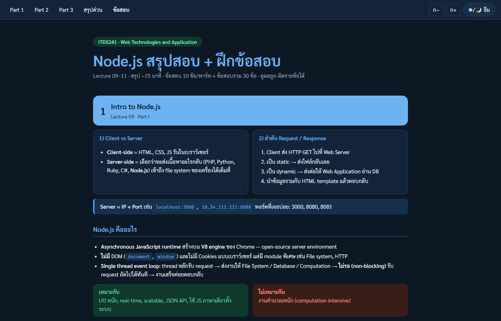

<div align="center">

# Node.js สรุปสอบ + ฝึกข้อสอบ

**ITDS241 Web Technologies and Application · Lecture 09–11**

อ่านสรุปจบใน ~15 นาที แล้วฝึกข้อสอบ 230 ข้อ ดูผลถูก–ผิดรายข้อได้ทันที

### [▶ กดเปิดอ่าน / ทำข้อสอบเลย](https://thinnaphat-tht.github.io/ITDS241-NodeJS-Quiz/ITDS241-NodeJS-Summary-Quiz.html)




</div>

---

## เริ่มใช้งาน

- **ออนไลน์:** กด [ลิงก์นี้](https://thinnaphat-tht.github.io/ITDS241-NodeJS-Quiz/ITDS241-NodeJS-Summary-Quiz.html) เปิดได้ทั้งมือถือและคอม
- **ออฟไลน์:** โหลด [`ITDS241-NodeJS-Summary-Quiz.html`](ITDS241-NodeJS-Summary-Quiz.html) (ปุ่ม Download raw file) แล้วดับเบิลคลิกเปิดในเบราว์เซอร์ ไม่ต้องลงอะไรเพิ่ม (ฟอนต์จะสวยขึ้นถ้าต่อเน็ต)

## ในไฟล์มีอะไร

| ส่วน | เนื้อหา |
|---|---|
| **Part 1 · Lecture 09** | Node.js คืออะไร, event loop, module (`require` / `module.exports`), `path` `url` `fs` `http`, sync vs async, callback hell |
| **Part 2 · Lecture 10** | Express, `npm`, `nodemon`, Router, `express.static`, form GET (`req.query`) vs POST (`req.body`) |
| **Part 3 · Lecture 11** | `.env` / `dotenv`, cookie, session, `mysql2`, SQL |
| **สรุปด่วน** | หน้า cheat sheet รวมทุก Lecture |

## ชุดข้อสอบ

| ชุด | จำนวน | ไว้ทำอะไร |
|---|---:|---|
| ซ้อมสอบ 1 | 10 ข้อ | พื้นฐานสุด ลองทำให้จบใน 15 นาที เหมือนสอบจริง (ไม่มีตัวจับเวลาในหน้า) |
| ซ้อมสอบ 2–6 | 20 ข้อ ต่อชุด | คำถามสั้น ๆ ตรงตัว เน้นเข้าใจเนื้อหา ข้อ 1–7 Lecture 9, ข้อ 8–14 Lecture 10, ข้อ 15–20 Lecture 11 |
| Part 1 / 2 / 3 | 10 ข้อ ต่อ Part | ทวนทีละ Lecture |
| ข้อสอบรวม 1 / 2 / 3 | 30 ข้อ ต่อชุด | ข้อ 1–10 Lecture 9, ข้อ 11–20 Lecture 10, ข้อ 21–30 Lecture 11 |

## ฟีเจอร์

- ทำทีละข้อ ตอบแล้วเฉลยพร้อมคำอธิบายทันที
- ตารางเลขข้อ แยกสี **ถูก / ผิด / ยังไม่ทำ**
- ปุ่ม **ทำเฉพาะข้อที่ผิดใหม่** และ **เริ่มชุดนี้ใหม่ทั้งหมด**
- สรุปคะแนนแยกตาม Lecture ตอนทำครบ จะได้รู้ว่าอ่อนตรงไหน
- คีย์ลัด: กด `1`–`4` เลือกคำตอบ, `←` `→` เปลี่ยนข้อ
- ธีมสว่าง/มืด และปรับขนาดตัวอักษรได้
- จำคำตอบไว้ในเบราว์เซอร์ (`localStorage`) ปิดแล้วเปิดใหม่ยังอยู่

## สร้างไฟล์ใหม่เอง

```bash
python build.py
```

แก้ข้อสอบและเนื้อหาใน `build.py` (ตัวแปร `P1` `P2` `P3` `FINAL` `F2` `F3` `PX`) แล้วรันใหม่ ได้ `ITDS241-NodeJS-Summary-Quiz.html`

## หมายเหตุ

- สรุปจากสไลด์ของอาจารย์ ไม่ได้รวมไฟล์สไลด์ไว้ใน repo
- ทำไว้ใช้อ่านสอบส่วนตัว อาจมีข้อผิดพลาด ถ้าเจอข้อที่เฉลยแปลก เปิด Issue ได้เลย
